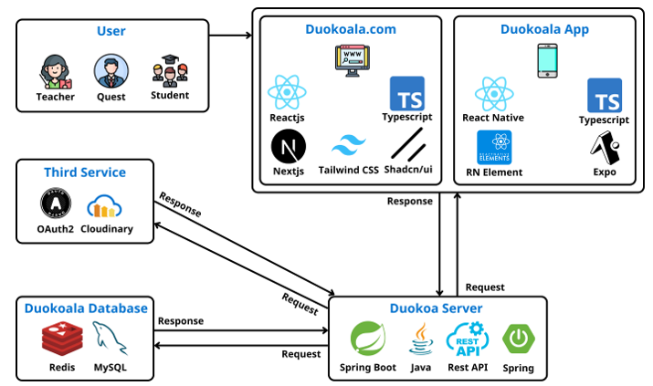

<div align="center">
  <h1>🎓 Multi-Koala</h1>
  <p><strong>Cross-Platform E-Learning & Course Sharing Ecosystem</strong></p>
  <p>A full-stack online learning platform featuring a Next.js web application, React Native mobile client, and a robust Java Spring Boot microservice backend.</p>

  <p>
    
    
    
    
    
    
    
  </p>
</div>

---

## 📖 Overview

**Multi-Koala** is an end-to-end e-learning platform engineered to seamlessly connect educators and students across multiple devices. It combines a responsive Next.js web dashboard, a cross-platform React Native (Expo) mobile application, and a centralized Java Spring Boot REST API for comprehensive course delivery, assessment, and progress tracking.

<p align="center">
  
</p>

---

## ✨ Key Features

### 👨‍🏫 For Instructors & Educators
- **Course Authoring & Management**: Effortlessly create, organize, and publish rich multi-chapter course curricula.
- **Lecture & Assessment Creation**: Upload lecture materials, organize multimedia resources, and configure automated quizzes.
- **Student Progress Analytics**: Real-time insights and granular analytics on enrollment, completion rates, and quiz performance.
- **Media Asset Management**: High-speed video and image uploading with Cloudinary integration.

### 👨‍🎓 For Students & Learners
- **Cross-Platform Access**: Seamless learning continuity across Desktop Web and Mobile (iOS / Android).
- **Interactive Quizzes & Self-Assessment**: Real-time evaluation with immediate grading and performance feedback.
- **Personalized Learning Tracker**: Bookmark courses, track completion percentages, and resume exactly where left off.
- **Optimized Mobile UX**: Native mobile gestures, smooth offline-ready caching, and responsive UI.

---

## 🛠 Tech Stack

### Client Applications
| Platform | Technology | Role |
|---|---|---|
| **Web Client** | Next.js, React, TypeScript, TailwindCSS | High-performance teacher/student portal with SSR capabilities |
| **Mobile Client** | React Native, Expo, TypeScript | Native iOS & Android cross-platform application |
| **State & API Sync**| Axios, React Hooks, Local Storage | Efficient data fetching and client-side caching |

### Backend & Cloud Infrastructure
| Layer | Technology | Role |
|---|---|---|
| **API Server** | Java 11+, Spring Boot, Spring Security | Centralized business logic, role-based authorization |
| **Database** | MySQL, Spring Data JPA / Hibernate | Relational persistence with transactional integrity |
| **Authentication** | JWT (JSON Web Tokens) & OAuth2 | Stateless authentication across Web and Mobile |
| **Media Storage** | Cloudinary CDN | Scalable cloud hosting for course assets and media |

---

## 📁 Repository Structure

```
multi-koala/
├── server/          # Java Spring Boot backend application
│   ├── src/main/java/com/koala/   # Controllers, Services, Models, Repositories
│   └── pom.xml                    # Maven build configuration
│
├── web/             # Next.js & TypeScript Web application
│   ├── src/components/            # Modular React components
│   ├── src/pages/                 # Web routes and views
│   └── package.json
│
├── mobile/          # React Native (Expo) Mobile application
│   ├── src/screens/               # Mobile UI screens (iOS/Android)
│   ├── src/navigation/            # Stack & Tab navigators
│   └── app.json                   # Expo application config
│
├── docs/            # Architecture diagrams & API specifications
└── README.md
```

---

## 🚦 Getting Started

### Prerequisites
- **Node.js**: v18.x or later
- **Java JDK**: 11 or later
- **Apache Maven**: 3.8+
- **MySQL**: 8.0+
- **Expo CLI**: `npm install -g expo-cli` (for mobile)

### 1. Database Setup
Create a MySQL database for the application:
```sql
CREATE DATABASE multikoala_db CHARACTER SET utf8mb4 COLLATE utf8mb4_unicode_ci;
```

### 2. Backend Service (Spring Boot)
Configure database credentials in `server/src/main/resources/application.properties`:
```properties
spring.datasource.url=jdbc:mysql://localhost:3306/multikoala_db?useSSL=false&serverTimezone=UTC
spring.datasource.username=your_db_user
spring.datasource.password=your_db_password
spring.jpa.hibernate.ddl-auto=update
```

Run the server:
```bash
cd server
mvn clean install
mvn spring-boot:run
```
*The REST API will be available at `http://localhost:8080`.*

### 3. Web Client (Next.js)
```bash
cd web
npm install
npm run dev
```
*Open [http://localhost:3000](http://localhost:3000) in your browser.*

### 4. Mobile Client (React Native / Expo)
```bash
cd mobile
npm install
npx expo start
```
*Scan the generated QR code using the **Expo Go** app on iOS or Android.*

---

## 🔒 Security & Architecture Design

- **Stateless Authentication**: JWT tokens issued upon authentication are validated via Spring Security filter chains across both Next.js and React Native clients.
- **Role-Based Access Control (RBAC)**: Strict segregation between `ROLE_TEACHER`, `ROLE_STUDENT`, and `ROLE_ADMIN` endpoints.
- **RESTful API Contracts**: Standardized HTTP status codes, centralized exception handling, and consistent JSON response schemas.

---

## 👥 Core Contributors

- **Nguyễn Văn Lẹ** — *Fullstack & Mobile Engineer* — [nguyenvanle1206@gmail.com](mailto:nguyenvanle1206@gmail.com) | [GitHub](https://github.com/Nguyenvanle)
- **Lê Dương Anh Tú** — *Software Engineer* — [leduonganhtu0102@gmail.com](mailto:leduonganhtu0102@gmail.com)
- **Nguyễn Lê Tiến Đạt** — *Software Engineer* — [tiendat29082003@gmail.com](mailto:tiendat29082003@gmail.com)

---

## 📄 License

Distributed under the MIT License. See `LICENSE` for details.
